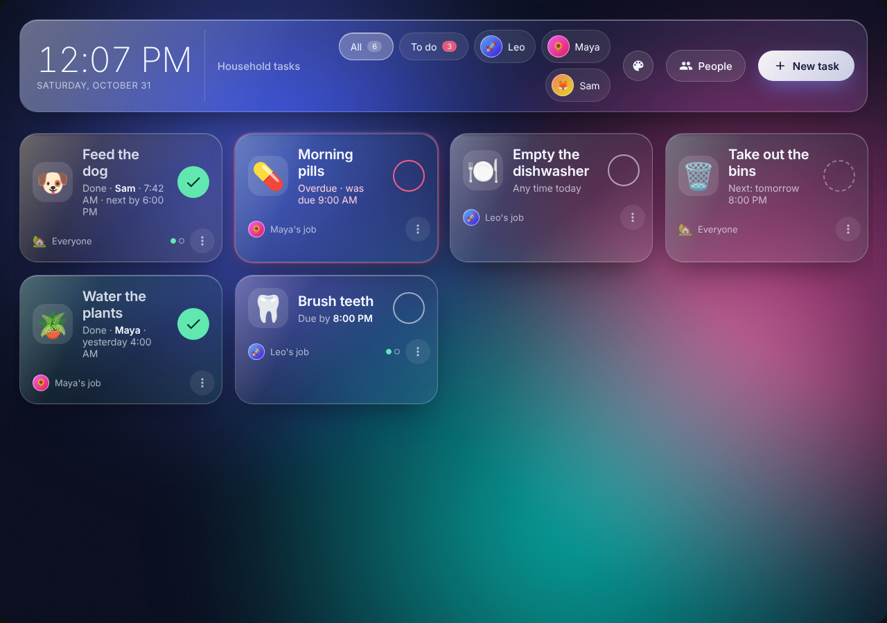
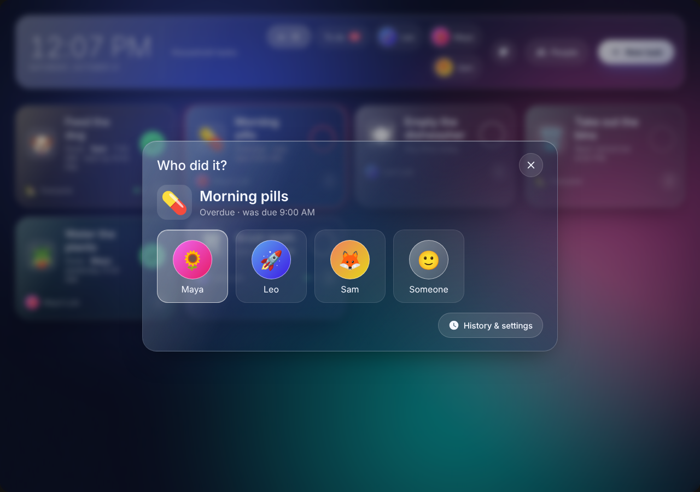
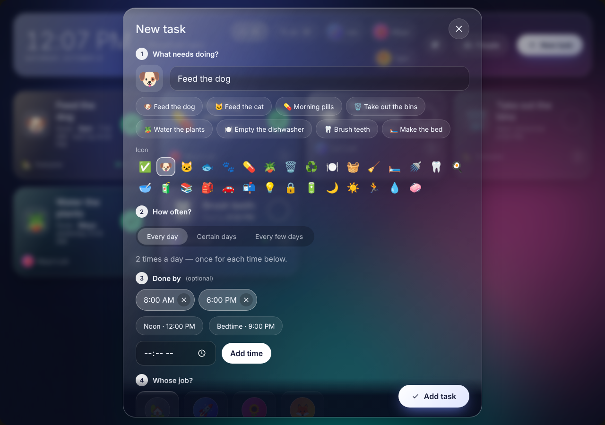
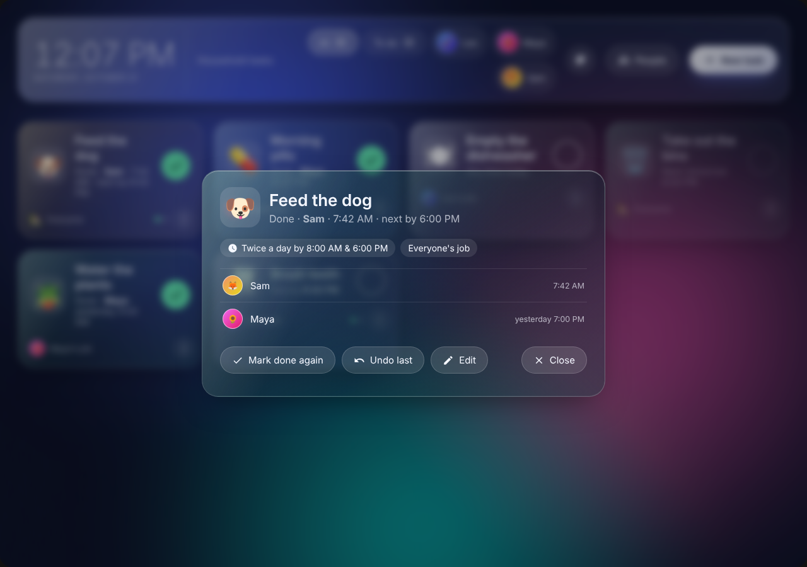
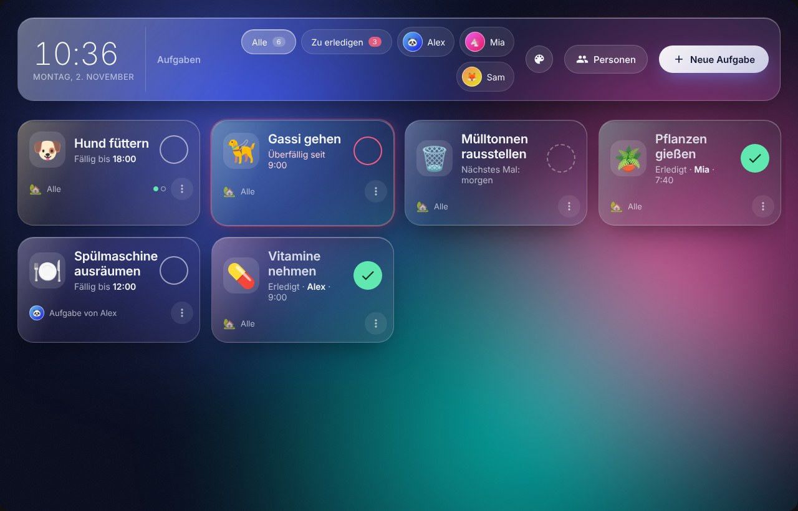
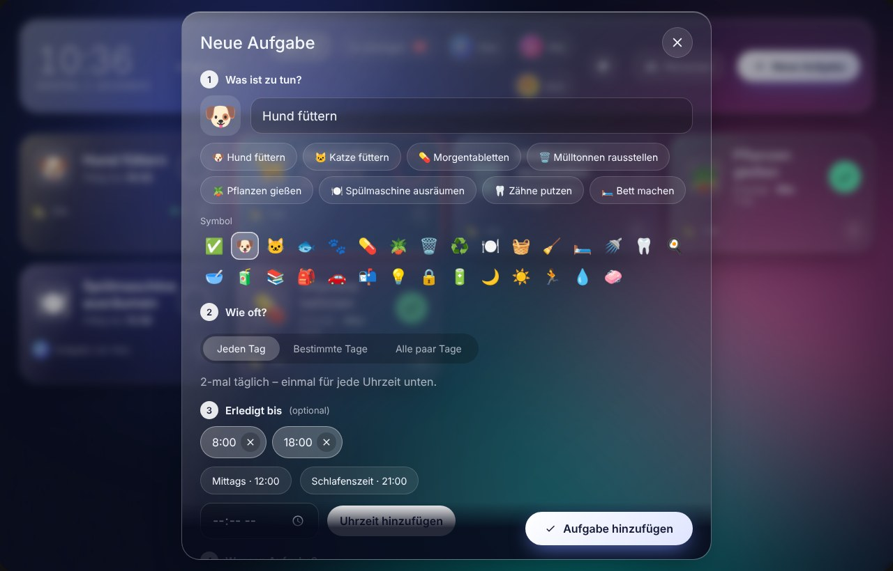
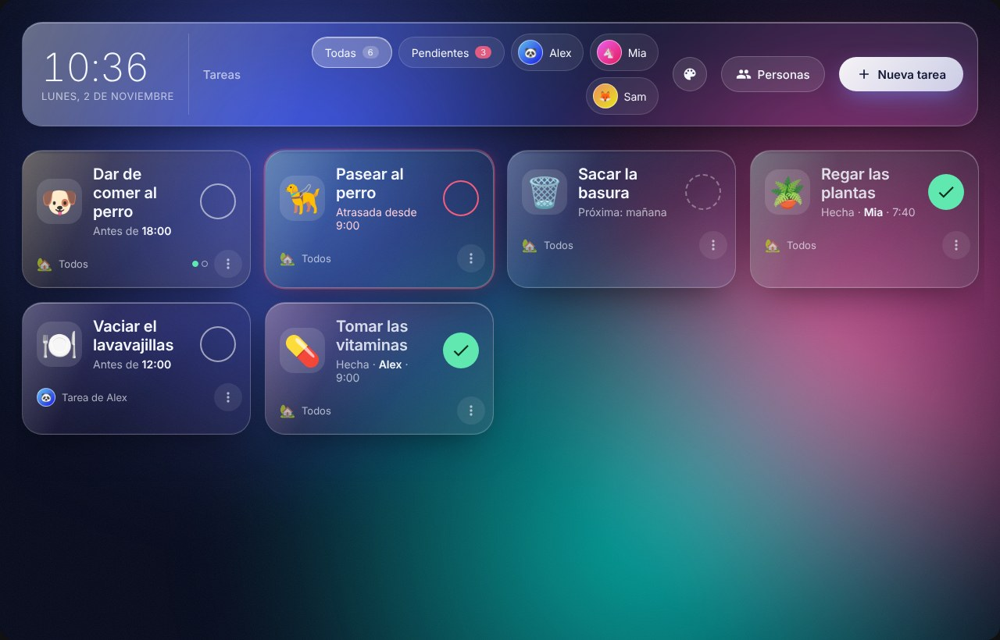
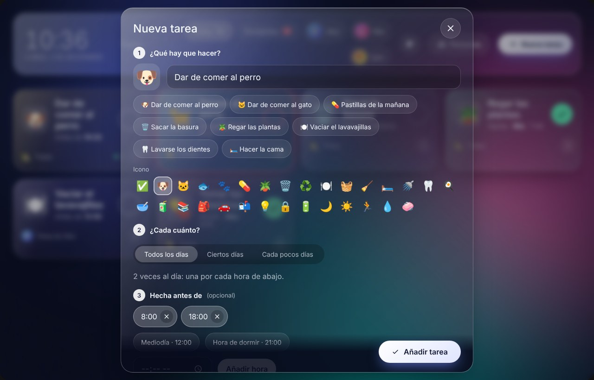
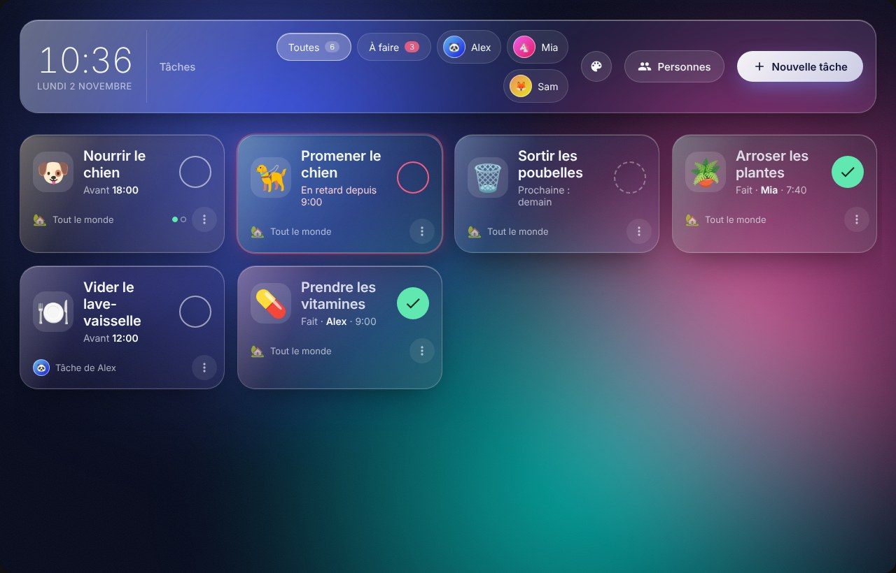
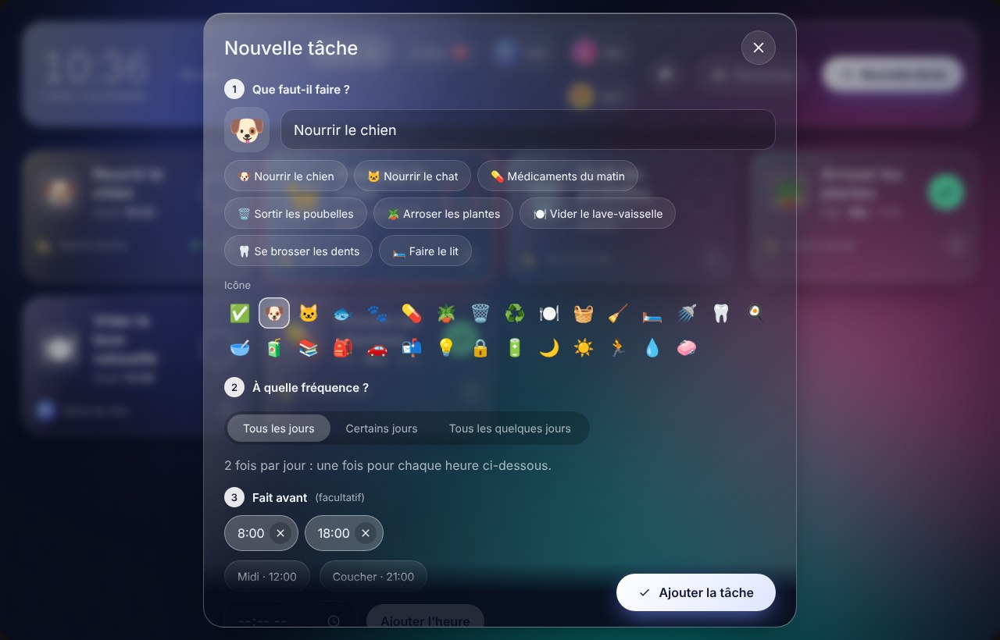

<div align="center">

# Glass Task Board

**A frosted-glass board for the jobs your home repeats, for Home Assistant.**

[](https://hacs.xyz/docs/faq/custom_repositories)
[](https://www.home-assistant.io/)
[](CHANGELOG.md)
[](#languages)
[](LICENSE)

</div>

Beautiful design and ease of use. https://github.com/Degederon/GlassTaskBoard

"Did someone already feed the dog?" Glass Task Board answers that at a glance. It turns a wall-mounted tablet into a board of recurring household tasks. Each task is a glass tile: tap it when it's done, pick who did it, and it resets on its own schedule. If something isn't done in time, the tile glows red and a reminder goes to that person's phone. When the tablet is idle, the board fades into an ambient clock that shows what's due next.

Glass Task Board is the companion to [Glass Message Board](https://github.com/Degederon/GlassMessageBoard) and shares its look, its colour themes and its People screen.

**Languages:** English, German (Deutsch), Spanish (Español) and French (Français). The board, its settings and its reminders follow your Home Assistant language.

## Contents

- [Features](#features)
- [Take a tour](#take-a-tour)
- [Requirements](#requirements)
- [Step-by-step setup](#step-by-step-setup)
- [Dashboard configuration](#dashboard-configuration)
- [Reminders](#reminders)
- [Actions](#actions)
- [Entities and events](#entities-and-events)
- [Automation examples](#automation-examples)
- [Permissions and data](#permissions-and-data)
- [WebSocket API](#websocket-api)
- [Languages](#languages)
- [Development](#development)
- [Troubleshooting](#troubleshooting)
- [Contributing](#contributing)
- [License](#license)

## Features

| Feature | Description |
|---|---|
| **Tap, pick a face, done** | Tapping a task asks "Who did it?" with everyone's picture. The tile then shows who did it and when. |
| **Resets on its own** | Every day, several times a day (feed the dog at 8 am *and* 6 pm), on certain weekdays (bins on Tuesday), or every few days counted from when it was last done (water the plants every 3 days). |
| **Overdue tasks stand out** | After their due time, tiles glow red and the person whose job it is (or everyone) gets a phone reminder. |
| **Late still counts** | Feeding the dog at 8:30 counts as the morning feed, not the evening one. |
| **Ready-made tasks** | Start from eight common jobs, such as feeding the pets, morning pills, bins night and watering the plants. |
| **History and undo** | See who did each task and when, and undo a tap made by mistake. |
| **Whose job** | Give a task to one person or to everyone, and filter the board by person or by **To do**. |
| **Simple people setup** | Add household members right on the board with a name, emoji picture and colour. No Home Assistant accounts required. Existing Home Assistant users can be shown too. |
| **Background themes** | Eleven colour presets, including seasonal ones, plus your own three-colour mix. Changes apply to every screen at once. |
| **Ambient mode** | After a configurable idle period, the board shows a large clock and a rotating spotlight of what's due. |
| **Automation support** | A sensor per task, actions to mark tasks done from a button, NFC tag or voice assistant, and events for completions and overdue tasks. |
| **Four languages** | English, German, Spanish and French: the board, its settings, its actions and its reminders follow your Home Assistant language. |

## Take a tour

All pictures are from the board itself, with example tasks.

<table>
<tr>
<td width="50%" valign="top"><br><sub>The board on a wall tablet: tasks to do, done and overdue.</sub></td>
<td width="50%" valign="top"><br><sub>Tap a task and pick who did it.</sub></td>
</tr>
<tr>
<td width="50%" valign="top"><br><sub>Add a task in four steps, or start from a ready-made one.</sub></td>
<td width="50%" valign="top"><br><sub>Open a task to see its history, undo the last tap or edit it.</sub></td>
</tr>
</table>

### Architecture

A single installation provides two components:

- **Integration** (`glass_tasks`): stores tasks and people, works out what's due, and provides actions, sensors, events and reminders.
- **Dashboard card** (`custom:glass-task-board`): the board itself, served by the integration and loaded on your dashboards.

## Requirements

- Home Assistant **2024.11** or later. On **2026.11** and later, install through the built-in **Marketplace**; on earlier versions, use **HACS**.
- A GitHub account, to add the repository to the Marketplace or HACS.

## Step-by-step setup

Follow these parts in order. Each one only needs to be done once.

### Part 1: Install the integration

**Using the Marketplace (Home Assistant 2026.11 and later)**

1. Go to **Settings → Marketplace**.
2. The first time, read the community-content warning and confirm.
3. Choose **Add via link**, paste `https://github.com/Degederon/GlassTaskBoard`, and choose **Integration** if asked. You may be asked to connect your GitHub account.
4. Open **Glass Task Board** and select **Install**.
5. Restart Home Assistant: **Settings → System**, select the power icon (top right), then **Restart Home Assistant**.

**Using HACS (earlier versions)**

1. In HACS, open the menu (⋮) and select **Custom repositories**.
2. Paste `https://github.com/Degederon/GlassTaskBoard`, choose the category **Integration**, and select **Add**.
3. Search for **Glass Task Board** and install it.
4. Restart Home Assistant.

**Manual installation**

1. Download the latest release.
2. Copy `custom_components/glass_tasks` into your `config/custom_components/` folder.
3. Restart Home Assistant.

### Part 2: Turn on the integration

Downloading the integration is not enough; it also has to be added.

1. Go to **Settings → Devices & services**.
2. Select **+ Add integration** (bottom right).
3. Search for **Glass Task Board**, select it, then select **Submit**.

To confirm it's working, open **Glass Task Board** on the **Devices & services** page. You should see a device with a **Tasks to do** sensor.

### Part 3: Load the board's display file

This happens automatically: the integration adds the board under **Settings → Dashboards → Resources** and keeps it on the current version after every update. You don't need to do anything.

After installing or updating, refresh the page once so your browser loads the board:

- **Computer:** press **Ctrl + Shift + R** (Mac: **Cmd + Shift + R**).
- **Companion app:** go to **Settings → Companion app → Debugging → Reset frontend cache**, then reopen the app.

<details>
<summary>Only if your dashboards are managed in YAML</summary>

If you manage dashboards in YAML (`lovelace: mode: yaml` in `configuration.yaml`), the integration can't edit your resources. It loads the board on every page instead, so it still works. If you prefer to list it yourself, add this under `lovelace: resources:`:

```yaml
- url: /glass_tasks/glass-task-board.js?v=0.2.0
  type: module
```

</details>

> [!TIP]
> To check that the file is reachable, open your Home Assistant address followed by `/glass_tasks/glass-task-board.js`, for example `http://homeassistant.local:8123/glass_tasks/glass-task-board.js`. You should see a page of code.

### Part 4: Create the dashboard

1. Go to **Settings → Dashboards** and select **+ Add dashboard**.
2. Choose **New dashboard from scratch**, then **Next**.
3. Enter the title `Household Tasks`, leave **Show in sidebar** on, and select **Create**.
4. Open **Household Tasks** from the sidebar.
5. Select the **pencil** icon (top right), then **⋮**, then **Raw configuration editor**.
6. Delete everything in the editor and paste:

   ```yaml
   title: Household Tasks
   views:
     - title: Tasks
       path: tasks
       icon: mdi:checkbox-marked-circle-outline
       type: panel
       cards:
         - type: custom:glass-task-board
           title: Household tasks
           ambient_after: 120
           column_width: 260
           show_clock: true
   ```

7. Select **Save**, close the editor with **X**, then select **Done**.

You should now see the glass board with a welcome screen.

> [!IMPORTANT]
> The Marketplace also adds a tile called **Glass Task Board – Up-to-date**. That tile only tracks updates; it is not the board. If you added it to a dashboard by mistake, edit the dashboard, select the tile and choose **Delete**.

### Part 5: Add your household

1. On the board, select **Add people** (or **People** in the header).
2. Type a name, then choose an emoji **Picture** and a **Colour**.
3. Optional: under **Remind them on their phone when their task is overdue**, choose that person's phone. Phones appear once the Home Assistant app is installed and signed in on them.
4. Select **Add person**. Repeat for everyone in your home.
5. Close the window with **X**.

To change someone later, open **People** and select **Edit** or **Remove** (select **Remove** twice to confirm).

> [!NOTE]
> Home Assistant users (`person` entities) appear on the board automatically. To hide them, open **People** and switch off **Home Assistant users**.

### Part 6: Add a task

1. Select **New task** (or **Add your first task** on a new board).
2. **What needs doing?** Type a name, or tap one of the ready-made tasks. Pick an **Icon**.
3. **How often?** Choose one:
   - **Every day**. Add a second due time below to make it twice a day.
   - **Certain days**: tap the weekdays it's due.
   - **Every few days**: use **−** and **+**. The days are counted from the last time it was done.
4. **Done by** (optional): tap **Morning**, **Noon**, **Evening** or **Bedtime**, or enter your own time and select **Add time**. Up to six times a day. With no time, the task can be done any time that day.
5. **Whose job?** Select a person, or **Everyone**.
6. Optional: select **More options** to choose a tile colour, or to switch off phone reminders for this task.
7. Select **Add task**.

### Part 7: Tick tasks off

- Tap a tile that's due. **Who did it?** opens: select your picture, or **Someone**. The tile turns green and shows who did it and when.
- Tasks due several times a day show a dot for each time.
- Use the buttons at the top to filter: **All**, **To do** (due or overdue), or a person to see their tasks and everyone's.
- Select **⋮** on a tile to see its history, **Mark done**, **Undo last** or **Edit** it. To remove a task, select **Edit**, then **Delete** twice.

### Part 8: Change the background (optional)

1. Select the **palette** button in the header, next to **People**.
2. Select a theme. The board changes straight away on every screen. **Aurora** is the default.
3. To use your own colours, change **Colour 1**, **Colour 2** and **Colour 3** under **Your own colours**. The board previews each change. Select **Use my colours** to keep them.
4. Close the window with **X**.

Available presets: Aurora, Black, Sunset, Ocean, Forest, Lavender, Ember, Graphite, Midnight, Halloween and Festive.

### What happens automatically

- **Resetting:** each task comes back on its schedule. A late tap fills the time that was due, not the next one.
- **Overdue:** once a due time passes, the tile glows red and the reminder is sent once.
- **Ambient mode:** after 120 seconds without a touch, the board shows a large clock and cycles through what's due. Tap anywhere to wake it.

## Dashboard configuration

For wall tablets, add the card to a **Panel** view (or a full-width **Sections** view) so it fills the screen. The card can be configured in the visual editor or in YAML:

```yaml
type: custom:glass-task-board
title: Household tasks
ambient_after: 120
height: 100vh
column_width: 260
group_by_status: false
show_clock: true
background_image: /local/wallpaper.jpg
```

| Option | Type | Default | Description |
|---|---|---|---|
| `title` | string | `Tasks` | Title shown in the header. Leave empty to hide it. |
| `ambient_after` | number | `120` | Seconds of inactivity before ambient mode starts. Set to `0` to disable. |
| `height` | string | Fills the viewport | Any CSS height, such as `100vh` or `720px`. |
| `column_width` | number | `260` | Minimum width of each tile, in pixels. |
| `group_by_status` | boolean | `false` | Shows **To do** tiles first, then **Done**, then **Coming up**, instead of a fixed order. |
| `show_clock` | boolean | `true` | Shows the clock and date in the header. |
| `background_image` | string | — | Optional image URL displayed behind the glass. |

> [!TIP]
> For a dedicated wall display, run the dashboard in kiosk mode, for example with Fully Kiosk Browser.

## Reminders

The easiest way to set up reminders is on the board itself: open **People**, edit a person and choose their phone. Phones appear in the list once the Home Assistant app is installed on them.

For Home Assistant `person` entities, and for extra settings, go to **Settings → Devices & services → Glass Task Board → Configure**.

| Setting | Description |
|---|---|
| **Per-person services** | The `notify` service(s) for each Home Assistant `person`, for example `notify.mobile_app_pixel_8`. |
| **Extra services for tasks that are everyone's job** | Additional services reminded for every overdue task that belongs to everyone. |
| **Reminder tap path** | Dashboard path to open when a reminder is tapped, for example `/lovelace/tasks`. |

**Delivery rules**

- An overdue task that is one person's job reminds that person's services.
- An overdue task that is everyone's job reminds every configured person, plus any extra services.
- Each overdue time sends one reminder. Switch reminders off for a single task under **More options** when editing it.

## Actions

| Action | Description | Fields |
|---|---|---|
| `glass_tasks.complete` | Marks a task done. | `task`, `by` |
| `glass_tasks.undo` | Takes back the most recent "done". | `task` |
| `glass_tasks.add_task` | Adds a task. Returns the task `id`. | `title`, `icon`, `repeat`, `days`, `every_days`, `times`, `assignee`, `tint`, `notify` |
| `glass_tasks.delete_task` | Removes a task. | `task` |
| `glass_tasks.set_background` | Changes the board's colour theme on every screen. | `preset`, `colors` |

`task` is a task's name (for example `Feed the dog`) or its id. `by` is a `person` entity or a board member ID (`member.…`); leave it out to use whoever ran the action.

### `glass_tasks.add_task` fields

| Field | Required | Description |
|---|---|---|
| `title` | Yes | What needs doing, up to 60 characters. |
| `icon` | No | An emoji for the tile. |
| `repeat` | No | `daily` (default), `weekly` or `every`. |
| `days` | No | For `weekly`: weekdays, where `0` is Monday and `6` is Sunday. |
| `every_days` | No | For `every`: the number of days, from 1 to 365, counted from the last time it was done. |
| `times` | No | Up to six due times, such as `["08:00", "18:00"]`. Leave out for "any time that day". |
| `assignee` | No | `everyone` (default), a `person` entity, or a board member ID. |
| `tint` | No | One of `clear`, `rose`, `amber`, `mint`, `sky`, `violet`. Default `clear`. |
| `notify` | No | Sends reminders when the task is overdue. Default `true`. |

```yaml
action: glass_tasks.add_task
data:
  title: Water the plants
  icon: 🪴
  repeat: every
  every_days: 3
  tint: mint
response_variable: task
```

## Entities and events

### Sensors

| Entity | State | Attributes |
|---|---|---|
| `sensor.glass_task_board_tasks_to_do` | Number of tasks due or overdue right now | Lists of the due and overdue task names |
| `sensor.glass_task_board_<task>` | `done`, `due`, `overdue` or `upcoming` | `due_at`, `next_due`, `last_done_by`, `last_done_at` and more |

### Events

`glass_tasks_completed` fires whenever a task is marked done:

| Key | Description |
|---|---|
| `id` | Task identifier |
| `title` | Task name |
| `by` / `by_name` | Who did it, as an entity or member ID and a display name |
| `at` | When it was done |

`glass_tasks_overdue` fires once when a task becomes overdue:

| Key | Description |
|---|---|
| `id` | Task identifier |
| `title` | Task name |
| `assignee` | `everyone`, a `person` entity or a board member ID |
| `due_at` | The due time that passed |

## Automation examples

### Flash a light if the dog hasn't been fed

```yaml
triggers:
  - trigger: state
    entity_id: sensor.glass_task_board_feed_the_dog
    to: overdue
actions:
  - action: light.turn_on
    target:
      entity_id: light.kitchen
    data:
      flash: long
```

### Tick a task off with an NFC tag

```yaml
triggers:
  - trigger: tag
    tag_id: dog-bowl
actions:
  - action: glass_tasks.complete
    data:
      task: Feed the dog
```

### Switch to a seasonal background

```yaml
triggers:
  - trigger: time
    at: "00:00:00"
conditions:
  - condition: template
    value_template: "{{ now().month == 10 and now().day == 31 }}"
actions:
  - action: glass_tasks.set_background
    data:
      preset: halloween
```

To use your own colours from an automation, set `preset: custom` and `colors: "#ff7a45, #ff3d77, #ffc15e"`. To go back to the default, set `preset: aurora`.

## Permissions and data

| Action | Allowed for |
|---|---|
| Mark done, undo, add, edit and remove tasks, manage people, change the background | All users |

- Tasks are stored locally in `.storage/glass_tasks.board`. No data leaves your Home Assistant instance except through the notification services you configure.
- Up to 100 tasks and 30 board members. Each task keeps its last 50 completions; the card shows the latest 12.

## WebSocket API

Custom frontends can use the following commands:

| Command | Description |
|---|---|
| `glass_tasks/subscribe` | Sends a snapshot of all tasks, people and settings, followed by `added`, `updated`, `removed` and `people` events. |
| `glass_tasks/task/save` | Adds a task, or updates one when `task_id` is given. |
| `glass_tasks/task/delete` | Removes a task. |
| `glass_tasks/task/complete` | Marks a task done, optionally `by` someone. |
| `glass_tasks/task/undo` | Takes back the most recent "done". |
| `glass_tasks/member/save` | Adds or updates a board member. |
| `glass_tasks/member/remove` | Removes a board member. |
| `glass_tasks/settings` | Shows or hides Home Assistant users, and changes the background. |

## Languages

Glass Task Board speaks four languages. Other languages show in English.

| Language | The board | Setup and options | Actions | Phone reminders |
|---|---|---|---|---|
| English | ✓ | ✓ | ✓ | ✓ |
| German (Deutsch) | ✓ | ✓ | ✓ | ✓ |
| Spanish (Español) | ✓ | ✓ | ✓ | ✓ |
| French (Français) | ✓ | ✓ | ✓ | ✓ |

- **The board** covers everything it says itself: buttons, task status, schedules, the task form and its ready-made tasks, background names, the People screen, the ambient screen and the card's settings. Task names and people's names stay exactly as people write them.
- **The board** follows the language in each person's Home Assistant profile: select your name at the bottom of the sidebar and set **Language**. Dates and times already followed it.
- **Setup, actions and phone reminders** follow Home Assistant's own language, under **Settings → System → General**.

The board and the task form in each language (the tasks are examples a household would add):

<table>
<tr>
<td width="50%" valign="top"></td>
<td width="50%" valign="top"></td>
</tr>
<tr><td colspan="2"><sub><b>Deutsch.</b> Die Aufgabentafel und das Aufgabenformular auf Deutsch.</sub></td></tr>
<tr>
<td width="50%" valign="top"></td>
<td width="50%" valign="top"></td>
</tr>
<tr><td colspan="2"><sub><b>Español.</b> El tablero de tareas y el formulario de tareas en español.</sub></td></tr>
<tr>
<td width="50%" valign="top"></td>
<td width="50%" valign="top"></td>
</tr>
<tr><td colspan="2"><sub><b>Français.</b> Le tableau des tâches et le formulaire de tâche en français.</sub></td></tr>
</table>

## Development

The schedule logic has no Home Assistant dependencies and comes with tests:

```sh
python3 tests/test_schedule.py
```

## Troubleshooting

### A red "Configuration error" box appears instead of the board

Your browser hasn't loaded the board's display file. Work through these steps in order and check the dashboard after each one.

1. Go to **Settings → Devices & services** and check that **Glass Task Board** is listed. If it isn't, complete [Part 2](#part-2-turn-on-the-integration).
2. Restart Home Assistant, then hard-refresh the page (**Ctrl + Shift + R**, or **Reset frontend cache** in the companion app). The restart adds the board to your dashboard resources automatically.
3. Go to **Settings → Dashboards → ⋮ → Resources** (turn on **Advanced mode** in your profile if you don't see it) and check that `/glass_tasks/glass-task-board.js` is listed as a **JavaScript module**. If it's missing, select **+ Add resource**, enter `/glass_tasks/glass-task-board.js` as a **JavaScript module**, and refresh again.
4. Open your Home Assistant address followed by `/glass_tasks/glass-task-board.js`, for example `http://homeassistant.local:8123/glass_tasks/glass-task-board.js`.
   - If you see a page of code, the file is fine: clear the browser cache and try again.
   - If you see **404: Not Found**, go to **Settings → System → Logs**, search for `glass`, and include what you find when reporting the problem.
5. Still red? Edit the dashboard, select the red card, and note the full error text underneath. Include it when reporting the problem.

### Other problems

| Problem | Solution |
|---|---|
| The board shows **Almost there** | The integration is downloaded but not added. Complete [Part 2](#part-2-turn-on-the-integration), then refresh the page. |
| A tile says **Glass Task Board – Up-to-date** | That is the update tracker, not the board. Delete the tile and add the board as described in [Part 4](#part-4-create-the-dashboard). |
| The board is small or squeezed | Edit the view (pencil next to the tab name) and set **View type** to **Panel**. |
| No phone reminders | Open **People**, edit the person and check that a phone is selected. For Home Assistant `person` entities, check **Settings → Devices & services → Glass Task Board → Configure**. Also check that the task's reminders aren't switched off under **More options**. |
| A phone is missing from the list | Install the Home Assistant app on that phone and sign in, then reopen the People screen. |
| A task tapped by mistake | Select **⋮** on the tile, then **Undo last**. |
| A task shows as done at the wrong time | Check Home Assistant's time zone under **Settings → System → General**. Due times use Home Assistant's time zone. |
| The Marketplace doesn't offer an update | Open **Glass Task Board** in the Marketplace, open the **⋮** menu and choose **Update information**. Updates appear once a new release is published on GitHub. |
| The board still looks like the old version after an update | Restart Home Assistant, then hard-refresh the browser or reset the companion app's frontend cache. The integration updates the version number in your resources automatically. |

## Contributing

Bug reports and pull requests are welcome. When reporting a problem, please include your Home Assistant version, browser, and any relevant entries from the Home Assistant log.

## License

Released under the [MIT License](LICENSE).
